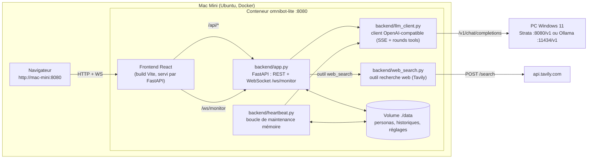
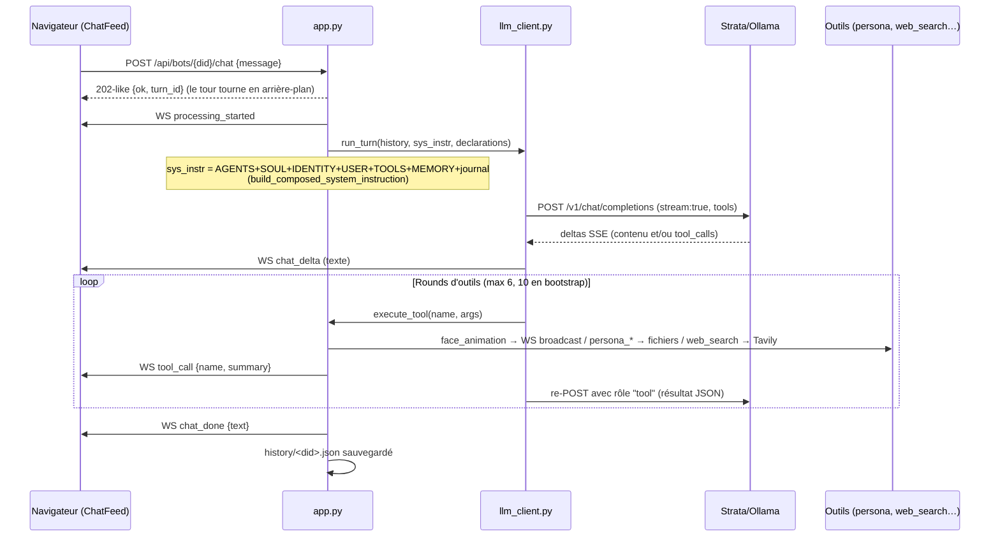

# omnibot-lite — Architecture

Doc de référence pour le debug. Tout est en français ; les noms de fichiers/tools sont en anglais comme dans le code.

## 1. Vue générale



Points clés :
- **Une seule image Docker** (Dockerfile multi-étapes) : le build Vite du frontend est embarqué, FastAPI sert le SPA + l'API sur le même port `8080`.
- Le hub ne fait **aucune** IA localement : tout passe par le serveur LLM distant (Strata ou Ollama) via `/v1/chat/completions`.
- Les **animations de visage** ne sortent pas du conteneur : elles sont diffusées en WebSocket vers le navigateur (visages SVG), plus exposées par `POST /api/bots/{id}/face-animation` pour un usage externe.
- `web_search` n'apparaît dans les outils du LLM **que si `TAVILY_API_KEY` est présent dans l'environnement du conteneur** (lu à chaque tour de chat, mais l'env du conteneur est figé à sa création → `docker compose up -d` après un changement de `.env`).

## 2. Déroulé d'un tour de chat (debug)



Ce qu'il faut surveiller quand un tour échoue :
- **`chat_error`** sur le WS = exception du tour (serveur LLM injoignable, HTTP ≥ 400…). Le message d'erreur est dedans.
- Les logs conteneur : `docker compose logs -f omnibot-lite` (lignes `[chat]`, `[llm]`, `[history]`, `[heartbeat]`).
- **Verrou par bot** (`turn_locks`) : chat et heartbeat du même bot ne tournent jamais en parallèle (le LLM distant ne sert qu'une requête à la fois).

## 3. Backend — fichier par fichier

| Fichier | Rôle | À regarder pour… |
|---|---|---|
| `app.py` | Hub FastAPI : tous les endpoints REST, WebSocket `/ws/monitor`, règles de base du système, déclarations d'outils du chat, dispatch `execute_tool`, servage du SPA, bootstrap « Give me a soul » | Tout ce qui est HTTP/WS ; ajout d'un nouvel outil (déclaration dans `_chat_declarations()` + branche dans `_make_execute_tool()`) |
| `llm_client.py` | Client OpenAI-compatible : streaming SSE, rounds d'outils, historique OpenAI, trim à 40 messages. `r.encoding = "utf-8"` (corrige le mojibake SSE) | Accents cassés, timeout, réponse vide, parsing des `tool_calls` |
| `persona.py` | Fichiers persona par bot (SOUL/IDENTITY/USER/TOOLS/MEMORY/HEARTBEAT/AGENTS), journal quotidien, BOOTSTRAP.md, composition de l'instruction système, outils persona (`soul_replace`, `persona_replace`…) + tailles max | Bot qui « oublie », persona qui n'est pas injecté, écriture de fichiers refusée (max 128 Ko) |
| `heartbeat.py` | Passe périodique : queue des journaux quotidiens → LLM → `memory_replace` uniquement. Intervalle et activation par bot (`bot_settings.json`) | MEMORY.md qui ne fusionne jamais, heartbeat qui tourne trop/souvent |
| `bots.py` | Registre des bots (`known_bots.json`) + réglages par bot (`bot_settings.json`), slug `device_id` | Bot disparu, doublon de slug, réglages heartbeat |
| `config.py` | `DATA_DIR` (env `OMNIBOT_DATA_DIR`), `hub_settings.json` (LLM base URL/modèle/clé modifiables via l'UI, fallback env `OMNIBOT_LLM_*`), charge `.env` local en dev | Hub qui parle au mauvais serveur LLM ; la clé API n'est jamais renvoyée en clair par l'API (masquée) |
| `animations.py` | Catalogue des 10 animations firmware + idle, paramètres de visage SVG, durée 2500 ms (`FACE_ANIMATION_DISPLAY_MS`) | Nom d'animation invalide, rendu du visage côté web |
| `web_search.py` | Outil `web_search` : déclaration + appel REST Tavily. Activé si `TAVILY_API_KEY` ; URL écrasable par `TAVILY_SEARCH_URL` (tests) | Outil absent de la liste du bot, erreur HTTP Tavily |
| `persona_defaults/*.md` | Templates FR injectés au premier démarrage de chaque bot (et via reset-persona) | Comportement par défaut des nouveaux bots |

### Endpoints REST (résumé)

```text
GET  /api/health                          état hub + LLM joignable
GET/POST /api/bots                        liste / créer bot
POST /api/bots/{id}/rename | DELETE /api/bots/{id}
GET/POST /api/bots/{id}/settings          heartbeat_enabled, heartbeat_interval_minutes
GET  /api/bots/{id}/history | POST …/chat-reset
POST /api/bots/{id}/chat                  {message} → tour en arrière-plan
POST /api/bots/{id}/bootstrap             démarre le rituel « Give me a soul »
GET/PUT /api/persona/{id}/{file}          lecture/écriture markdown (soul|identity|user|tools|memory|heartbeat|agents)
GET  /api/persona/{id}/status
POST /api/bots/{id}/reset-persona         re-seed depuis persona_defaults
GET  /api/animations                      catalogue 11 visages
POST /api/bots/{id}/face-animation        déclenche une animation (usage externe)
GET/POST /api/hub/settings                LLM base_url/model/clé (clé masquée en GET)
POST /api/bots/{id}/heartbeat/run         force une passe heartbeat
WS   /ws/monitor                          events : processing_started, chat_delta, tool_call,
                                          face_animation, chat_done, chat_error, persona_file_changed
GET  /*                                   SPA React (fallback deep-link) ; /api inconnu → 404 JSON
```

### Outils vus par le LLM (chat)

`face_animation`, `soul_replace`, `memory_replace`, `persona_replace`, `daily_log_append`, `bootstrap_complete`, et `web_search` **seulement si** `TAVILY_API_KEY` est défini. En heartbeat : `memory_replace` uniquement.

## 4. Données runtime (`./data` monté dans `/data`)

```text
data/
├── hub_settings.json          LLM base_url / model / api_key (prioritaires sur l'env)
├── known_bots.json            device_id -> {display_name, created_at}
├── bot_settings.json          device_id -> {heartbeat_enabled, heartbeat_interval_minutes}
├── history/<device_id>.json   messages OpenAI bruts (user/assistant/tool), trim 40
└── persona/<device_id>/
    ├── AGENTS.md SOUL.md IDENTITY.md USER.md TOOLS.md MEMORY.md HEARTBEAT.md
    ├── BOOTSTRAP.md           présent seulement pendant le rituel de naissance
    ├── logs/daily/YYYY-MM-DD.md   journal brut (daily_log_append)
    └── .heartbeat_state.json  dernière passe heartbeat (date, résumé)
```

⚠️ Ces fichiers sont **bruts et éditables à la main** (c'est la mémoire des bots). Un bot dont l'historique a été corrompu (ex. mojibake d'avant le correctif utf-8) se nettoie via « Historique ⌫ » (`chat-reset`) et/ou `reset-persona`.

## 5. Frontend — fichier par fichier

| Fichier | Rôle |
|---|---|
| `src/main.jsx`, `index.html` | Entrée Vite/React |
| `src/App.jsx` | Orchestration : sélection du bot, connexion WS, distribution des événements |
| `src/api.js` | Tous les appels REST (`/api/*`) centralisés |
| `src/components/Sidebar.jsx` | Liste des bots, création/suppression/renommage |
| `src/components/ChatFeed.jsx` | Chat + rendu des `chat_delta`/`tool_call`, bouton reset |
| `src/components/FacePreview.jsx` | Visage SVG paramétrique rejouant les 10 expressions + idle |
| `src/components/PersonaEditor.jsx` | Édition des 7 markdown persona |
| `src/components/BotSettings.jsx` | Réglages heartbeat par bot |
| `src/components/HubSettings.jsx` | Base URL / modèle / clé LLM (via `/api/hub/settings`) |

Le WS se reconnecte automatiquement ; les événements ne sont **pas** rejoués → un bot qui a répondu pendant une coupure WS aura quand même sauvegardé sa réponse dans l'historique (visible au rechargement).

## 6. Build & déploiement

| Fichier | Rôle |
|---|---|
| `Dockerfile` | Multi-étapes : stage 1 `npm ci && vite build`, stage 2 Python + `uvicorn` ; le SPA est copié et servi par FastAPI. Port interne **8080** |
| `docker-compose.yml` | Port hôte `8080:8080` (changer la **gauche** si occupé), volume `./data:/data`, passe-through env `OMNIBOT_LLM_*` et `TAVILY_API_KEY` depuis `.env` |
| `.env.example` → `.env` | Modèle de config (jamais commité) |
| `scripts/dev.sh` | Dev local sans Docker : uvicorn :8080 + Vite :5173 (proxy `/api` + `/ws`) |
| `scripts/fake_llm_server.py` | Faux LLM OpenAI + mock Tavily `/search` : « visage » → tool_call face ; « cherche » → tool_call web_search |
| `scripts/smoke.sh` + `smoke_test.py` | Bout-en-bout hors Docker (data dans `/tmp/opencode/…`, hub :8090) |

## 7. Table de debug rapide

| Symptôme | Cause probable | Vérifier |
|---|---|---|
| Le bot ne voit pas `web_search` | Image pas rebuild (`--build` oublié) ou clé absente du conteneur | `git pull && docker compose up -d --build`, puis `docker compose exec omnibot-lite printenv TAVILY_API_KEY` |
| Accents/emoji cassés | Régression utf-8 SSE | `r.encoding = "utf-8"` dans `llm_client._stream_completion` ; le smoke teste accents/’/🐶 |
| `chat_error` « Serveur LLM injoignable » | Strata lancé sans `--access lan`, IP/firewall, `hub_settings.json` pointant au mauvais serveur | `/api/health` → `llm_base_url` + `llm_reachable` |
| Hub ne répond plus sur le port | Port hôte 8080 pris par un autre conteneur | `docker ps --filter publish=8080`, changer `ports:` côté gauche |
| Bot muet alors que le health est vert | Verrou de tour occupé (heartbeat en cours) | logs `[heartbeat]`, `POST …/heartbeat/run` pour reproduire |
| MEMORY.md ne se met jamais à jour | `heartbeat_enabled: false` ou intervalle énorme dans `bot_settings.json` ; HEARTBEAT.md vidé | `data/bot_settings.json`, `data/persona/<id>/.heartbeat_state.json`, logs |
| Bot dit n'importe quoi sur ses souvenirs | Historique/persona corrompus | `data/history/<id>.json` ; chat-reset et reset-persona |
| 404 sur une page SPA deep-link | Fallback SPA cassé (route `/{full_path:path}` de `app.py`) | `/api/inconnu` doit être 404 JSON, tout le reste index.html |
